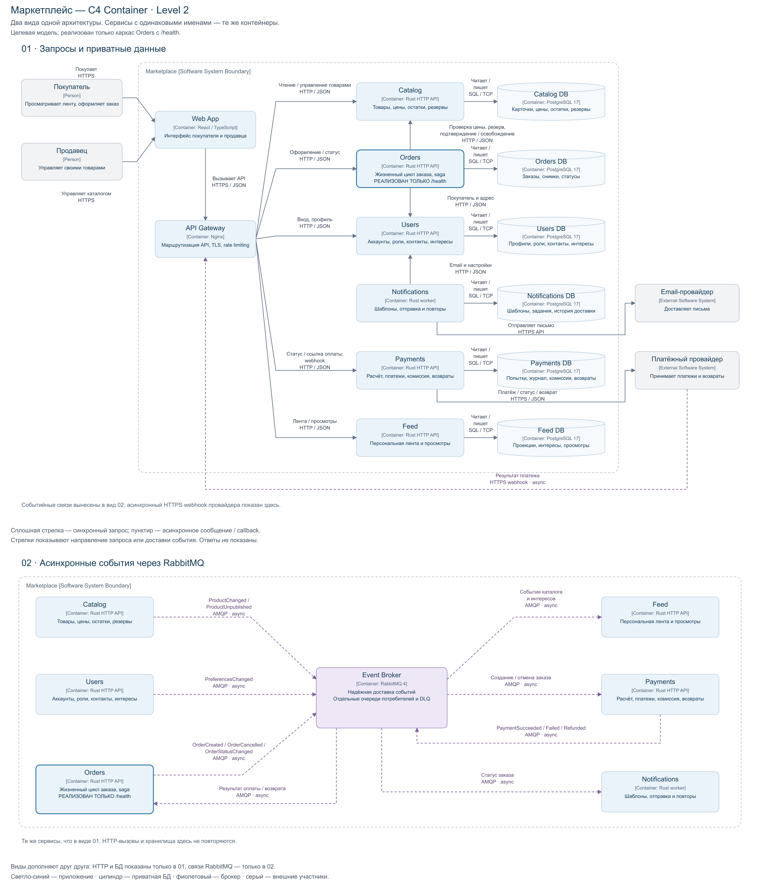

# Marketplace

Rust + Axum, PostgreSQL, Flyway. Текущая версия — ДЗ 2: товары, заказы,
промокоды, JWT и роли. Каркас ДЗ 1 без бизнес-логики —
[коммит 9d9e237](https://github.com/TheAngryAndry/Service-oriented_architectures/tree/9d9e237).

## Запуск

Нужны Docker Engine и Compose v2. Из корня проекта:

```sh
docker compose up --build -d --wait --wait-timeout 180
curl -i http://localhost:8080/health
```

Compose запускает PostgreSQL, применяет миграции Flyway и поднимает API.
Ожидаемый ответ: `200 OK`, `{"status":"ok"}`. Health проверяет соединение с БД.
Остановка: `docker compose down`.

Порт задаётся через `ORDERS_PORT` (8080), интервал между операциями заказа —
через `ORDER_INTERVAL_MINUTES` (1 минута). Переменные можно задать в `.env`.

Просмотр данных на защите:

```sh
docker compose exec -T postgres psql -U marketplace -d marketplace \
  -c 'SELECT id,status,total_amount FROM orders;'
```

## OpenAPI и кодогенерация

[Контракт](services/orders/openapi/openapi.json) также доступен на `/openapi.json`.
Он описывает методы, роли, схемы, ограничения и ошибки.

`build.rs` генерирует DTO и хэндлеры при сборке, включая Docker-сборку.
Результат находится в `target/` и исключён из Git. Локальная команда (Rust 1.91+):

```sh
cargo build --locked --manifest-path services/orders/Cargo.toml
```

## Архитектура ДЗ 1



Это целевая архитектура. Два вида на диаграмме показывают одни и те же сервисы:
синхронные запросы и данные сверху, асинхронные события снизу.

| Домен → сервис | Ответственность | Собственные данные |
| --- | --- | --- |
| Пользователи → Users | Вход, роли, профили | Аккаунты, хеши паролей, контакты, адреса, интересы |
| Каталог → Catalog | Публикация товаров, цены, резервирование | Товары, продавцы, категории, цены, остатки, резервы |
| Лента → Feed | Ранжирование по интересам и просмотрам | Проекции каталога и интересов, просмотры |
| Заказы → Orders | Оформление, статусы, координация оплаты | Заказы, позиции, снимки цен, суммы, адрес доставки |
| Платежи → Payments | Расчёт списаний и комиссии, учёт оплат и возвратов | Платёжные попытки, финансовые записи, ID провайдера |
| Уведомления → Notifications | Доставка сообщений о заказах, повторы | Шаблоны, задания, история доставки |

У каждого сервиса своя PostgreSQL. Доступ к чужим таблицам запрещён;
обмен — через API и события. Feed хранит проекцию, Catalog — актуальные цены
и остатки. Web App и Gateway не владеют доменными данными.

### Взаимодействия

| Связь | Способ и назначение |
| --- | --- |
| Web App → Gateway → Users, Catalog, Feed, Orders, Payments | Синхронно, HTTP/JSON: пользовательские запросы; снаружи HTTPS |
| Orders → Users, Catalog | Синхронно, HTTP/JSON: покупатель, адрес, цены и резервы |
| Notifications → Users | Синхронно, HTTP/JSON: контакты и согласия |
| Payments → платёжный провайдер; Notifications → email-провайдер | Синхронно, HTTPS: платежи и отправка писем |
| Платёжный провайдер → Gateway → Payments | Асинхронный HTTPS webhook: результат оплаты |
| Catalog, Users → RabbitMQ → Feed | Асинхронно, AMQP: изменения товаров и интересов |
| Orders → RabbitMQ → Payments | Асинхронно, AMQP: создание и отмена платежа |
| Payments → RabbitMQ → Orders | Асинхронно, AMQP: результат оплаты или возврата |
| Orders → RabbitMQ → Notifications | Асинхронно, AMQP: изменение статуса заказа |

### Варианты и выбор

| Вариант | Плюсы | Минусы |
| --- | --- | --- |
| Модульный монолит: один backend и БД, вызовы внутри процесса | Простые транзакции, один релиз, дешевле эксплуатация | Лента масштабируется вместе с заказами; сбои и релизы затрагивают весь backend |
| Шесть доменных сервисов: отдельные БД, HTTP и RabbitMQ | Независимое масштабирование Feed; изоляция платежей и сбоев уведомлений | Шесть БД и брокер; задержки событий, компенсации, сложнее отладка |

Для ДЗ 1 выбраны шесть сервисов: лента требует отдельного масштабирования,
платежи — изоляции финансовых данных, уведомления — независимости от внешнего
email-провайдера. Покупатели и продавцы объединены в Users, а товары и остатки —
в Catalog для локальных транзакций резервирования. Цена выбора — распределённые
сбои: нужны идемпотентность, повторы, outbox и компенсации; в каркасе их нет.

### Реализация ДЗ 2

Auth, Catalog и Orders объединены в одно Rust-приложение с одной PostgreSQL:
заказ, остатки и промокод должны изменяться в одной ACID-транзакции.
Разделение по БД потребовало бы компенсаций вместо атомарного отката.
Feed, Payments, Notifications и RabbitMQ пока остаются проектом ДЗ 1.
