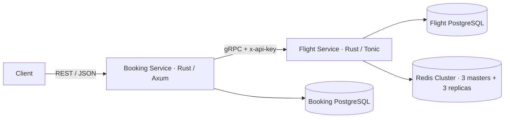
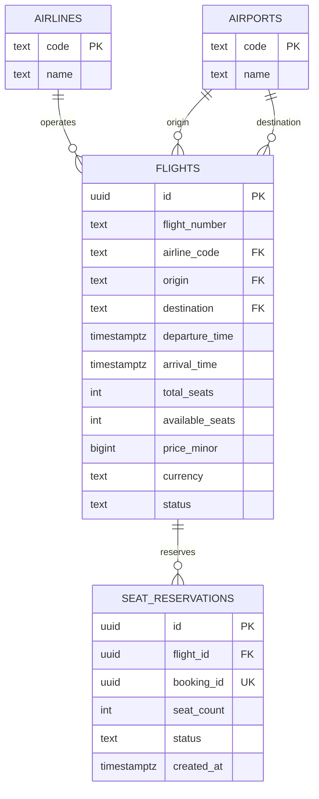
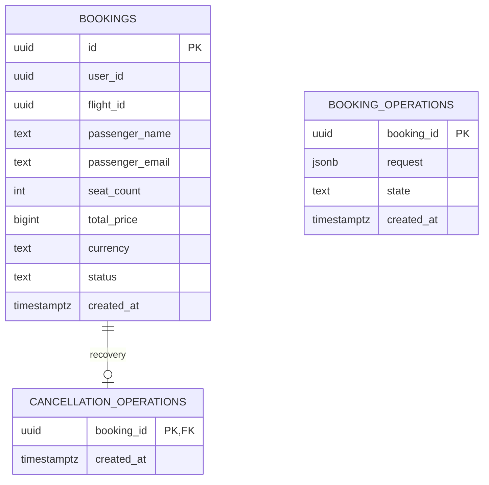

# ДЗ 3. Flight Booking на Rust

Два микросервиса: **Booking Service** (REST/Axum) и **Flight Service**
(gRPC/Tonic). У каждого — собственный PostgreSQL. Flight использует Redis Cluster:
3 мастера и 3 реплики. Реализованы пункты 1–10 задания.

## Запуск

Из этой папки, с Docker Engine и Docker Compose v2:

```sh
docker compose up --build -d --wait --wait-timeout 180
curl http://localhost:8083/health
```

Для запуска в переднем плане: `docker compose up --build`.
Миграции SQLx встраиваются в бинарники и автоматически применяются при старте.
`protoc` из Cargo-зависимости генерирует Rust-клиент и сервер из
[flight.proto](proto/flight.proto) при сборке. Системный Rust или protoc для Docker-запуска не нужен.

REST: `localhost:8083`. gRPC: `localhost:50053`.
Базы и Redis наружу не публикуются. Демо-учётные данные предназначены для локальной
проверки. Остановка с сохранением данных: `docker compose down`.

### Проверка вручную

Есть тестовые рейсы SVO → LED на **2027-04-01**.
Рейс `11111111-1111-4111-8111-111111111111` — 100 мест, 5500 RUB;
`22222222-2222-4222-8222-222222222222` — одно место.

```sh
curl 'http://localhost:8083/flights?origin=SVO&destination=LED&date=2027-04-01'

curl -X POST http://localhost:8083/bookings \
  -H 'Content-Type: application/json' \
  -H 'Idempotency-Key: aaaaaaaa-aaaa-4aaa-8aaa-aaaaaaaaaaaa' \
  -d '{"user_id":"bbbbbbbb-bbbb-4bbb-8bbb-bbbbbbbbbbbb","flight_id":"11111111-1111-4111-8111-111111111111","passenger_name":"Ivan Ivanov","passenger_email":"ivan@example.com","seat_count":2}'

curl http://localhost:8083/bookings/aaaaaaaa-aaaa-4aaa-8aaa-aaaaaaaaaaaa
curl -X POST http://localhost:8083/bookings/aaaaaaaa-aaaa-4aaa-8aaa-aaaaaaaaaaaa/cancel
```

Все денежные значения — **целые копейки**: `price_minor` и `total_price`.
Часовой пояс поиска по дате — UTC. `Idempotency-Key` — необязательный UUID:
повтор с тем же телом возвращает прежнюю бронь, с другим телом — 409.

## Архитектура



Сервисы не читают чужие таблицы. Связь `bookings.flight_id` и
`seat_reservations.booking_id` — логическая, без межбазовых FK.

## Контракты

| REST | Поведение |
| --- | --- |
| `GET /flights?origin=SVO&destination=LED&date=2027-04-01` | SearchFlights; origin/destination обязательны, date опциональна; только SCHEDULED |
| `GET /flights/{id}` | GetFlight |
| `POST /bookings` | user_id, flight_id, passenger_name, passenger_email, seat_count; GetFlight → ReserveSeats → CONFIRMED |
| `GET /bookings/{id}` | Бронь из собственной БД |
| `POST /bookings/{id}/cancel` | ReleaseReservation → CANCELLED; повтор безопасен |
| `GET /bookings?user_id=UUID` | Брони одного пользователя |
| `GET /health` | Доступность Booking PostgreSQL |

Успешное создание возвращает 201, повтор по ключу — 200. Список поиска имеет
форму `{"flights":[...]}`, список броней — массив. Бронь содержит `id`,
поля запроса, `total_price`, `currency`, `status`, `created_at`.
Даты REST — RFC 3339, gRPC — `google.protobuf.Timestamp`.
Статусы gRPC представлены enum.

Обязательные RPC: SearchFlights, GetFlight, ReserveSeats, ReleaseReservation.
Дополнительно UpdateFlight меняет цену, вместимость и статус; нельзя уменьшить
вместимость ниже количества занятых мест. Все пять методов защищены
interceptor, проверяющим `x-api-key`; отсутствие/неверный ключ → UNAUTHENTICATED.

| gRPC | REST | Причина |
| --- | --- | --- |
| INVALID_ARGUMENT | 400 | Некорректный UUID, IATA, дата, количество, поля пассажира |
| NOT_FOUND | 404 | Рейс или бронь не найдены |
| RESOURCE_EXHAUSTED | 409 | Не хватает мест |
| FAILED_PRECONDITION | 409 | Рейс не SCHEDULED, резерв уже освобождён, недопустимая вместимость |
| ALREADY_EXISTS | 409 | Ключ повторно использован с другими параметрами |
| UNAVAILABLE / DEADLINE_EXCEEDED | 503 | Инфраструктурная ошибка или открытый circuit breaker |
| UNAUTHENTICATED | 503 | Неверная конфигурация межсервисного ключа |

JSON ошибок: `{"error":{"code":"NotFound","message":"flight not found"}}`.

## ER-диаграмма и 3NF

**Flight PostgreSQL:**



**Booking PostgreSQL:**



Авиакомпания и аэропорты вынесены в справочники: их названия не дублируются в
рейсах. В каждой доменной таблице неключевые атрибуты зависят от ключа и не
имеют транзитивных зависимостей. Пассажир — снимок конкретного бронирования,
а не профиль пользователя; один user_id может бронировать для разных пассажиров.
Стоимость брони — исторический снимок, не функция текущей цены рейса.

Уникальность рейса задаётся индексом на номер + UTC-дату вылета.
CHECK-ограничения обеспечивают положительные цену, вместимость и seat_count,
`0 <= available_seats <= total_seats`, разные аэропорты, корректный порядок дат
и допустимые статусы. booking_id у резерва уникален.
SQL: [Flight](migrations/flight/0001_init.sql), [Booking](migrations/booking/0001_init.sql).

Технические таблицы Flight: `cache_revision` (одно значение версии) и
`released_booking_ids` (ключи запрета позднего резерва). Журнал
`booking_operations` хранит незавершённые запросы отдельно от подтверждённых броней.

## Транзакции и восстановление

ReserveSeats берёт advisory lock по booking_id и **SELECT FOR UPDATE** по рейсу.
Проверка наличия мест, уменьшение остатка, запись резерва и смена версии кэша
выполняются в одной транзакции. Повтор активного резерва с теми же параметрами
возвращает существующий результат без повторного списания.

ReleaseReservation возвращает места и меняет статус в одной транзакции.
Он идемпотентен. Даже для неизвестного booking_id записывается отменяющая
метка: задержавшийся ReserveSeats после компенсации не сможет занять места.

Booking сохраняет CONFIRMED только после успешного ReserveSeats; цена фиксируется
по результату GetFlight с проверкой переполнения. При ошибке резервирования
запись в bookings не появляется. Для сбоя между удалённым резервом и локальным
commit есть предварительно сохранённый журнал и компенсация.

Это **saga**, а не общая ACID-транзакция двух БД. При аварии процесса или сети
удалённый резерв может временно сохраняться до компенсации. Фоновый обработчик
каждые 2 секунды повторяет компенсации и отмены; осиротевший PENDING подбирается
через 30 секунд. Заблокированная активным запросом операция пропускается через
SKIP LOCKED. Неопределённый исход commit проверяется через журнал, поэтому
успешная бронь не освобождается вслепую. Отмена также имеет устойчивый журнал
на случай сбоя после ReleaseReservation.

## Кэширование и отказоустойчивость

- Cache-Aside для GetFlight и SearchFlights: Redis GET; при miss — основной
  запрос к PostgreSQL и SET с EX. Данные кодируются Protobuf.
- TTL по умолчанию 300 секунд. Логи: cache_hit, cache_miss, cache_timeout.
- Перед выбором ключа читается маленькая версия `cache_revision` из PostgreSQL.
  Ключи: `flight:{id}:v{revision}`,
  `search:{origin}:{destination}:{date-or-all}:v{revision}`.
  ReserveSeats, ReleaseReservation и UpdateFlight увеличивают версию **в своей
  транзакции**. Старые ключи становятся недоступны новым чтениям и удаляются по TTL.
  Это устраняет повторное заполнение устаревшего кэша конкурентным чтением и
  возврат старых данных после восстановления Redis. Цена решения — один короткий
  metadata-запрос к БД на чтение и общая инвалидизация пространства ключей.
- Ошибки и таймаут Redis не срывают операции: Flight использует PostgreSQL.
- Redis Cluster: 16384 слота, 3 мастера, по реплике на мастер; данные сохраняются
  в volumes, включён AOF. Bootstrap ожидает синхронизации всех реплик. `redis::cluster_async::ClusterConnection` отслеживает
  MOVED/ASK, переподключение и изменение топологии. Чтение с мастеров.
- Общий клиентский middleware [client.rs](src/client.rs) делает **не более 3
  попыток** только при UNAVAILABLE и DEADLINE_EXCEEDED. Задержки 100, 200 мс.
  Один booking_id сохраняется на всех попытках ReserveSeats.
- Circuit breaker: CLOSED → OPEN после 5 неудачных логических вызовов подряд;
  OPEN сразу даёт 503 без сети; через 10 секунд HALF_OPEN пропускает один вызов
  без повторов. Успех закрывает circuit, ошибка открывает снова.
  Бизнес-ошибки не считаются отказом сервиса. Отмена пробного запроса освобождает
  HALF_OPEN. Поздний ответ старого поколения не меняет новое состояние.
  Переходы пишутся в JSON-логи как circuit_transition.

## Конфигурация

Переменные можно передать окружением или через локальный `.env`:

| Переменная | По умолчанию |
| --- | --- |
| BOOKING_PORT / FLIGHT_PORT | 8083 / 50053 |
| GRPC_API_KEY | homework-local-api-key |
| FLIGHT_DB_PASSWORD / BOOKING_DB_PASSWORD | flights-local / bookings-local |
| CACHE_TTL_SECONDS / CACHE_TIMEOUT_MS | 300 / 200 |
| GRPC_TIMEOUT_MS / RETRY_BASE_MS | 2000 / 100 |
| CB_FAILURE_THRESHOLD / CB_OPEN_MS | 5 / 10000 |

Для запуска бинарников вне Compose обязательны DATABASE_URL и GRPC_API_KEY;
Flight также требует REDIS_CLUSTER_NODES, Booking — FLIGHT_GRPC_URL.
Публичная пользовательская авторизация не входит в задание: user_id передаёт клиент.

## Автотесты

[Результаты проверки: 20/20](VERIFICATION.md).

Локально с Rust 1.95+:

```sh
cargo fmt --check
cargo clippy --locked --all-targets --all-features -- -D warnings
cargo test --locked
```

Полный набор с настоящими PostgreSQL, gRPC и Redis после запуска Compose:

```sh
docker compose --profile test run --build --rm tests
```

Проверяются REST-флоу, снимок цены, валидация, ограничения БД, аутентификация
каждого RPC, одновременные повторы, **20 претендентов на последнее место**,
TTL/cache hit/инвалидизация и восстановление незавершённых операций.
Обычный cargo test пропускает только тесты, требующие Compose.

Проверки реальных отказов запускаются **на Docker-хосте** отдельно
и последовательно; они временно останавливают только контейнеры этого ДЗ:

```sh
cargo test --locked --features fault-tests --test faults -- --ignored --test-threads=1
# Если Docker требует sudo:
DOCKER_SUDO=1 cargo test --locked --features fault-tests --test faults -- --ignored --test-threads=1
```

Проверяются отказ Flight и восстановление circuit breaker, остановка всех Redis
с продолжением бронирований через PostgreSQL, возвращение кэша без старых данных
и автоматическое повышение реплики после остановки мастера.
Контейнеры запускаются обратно даже при падении проверки.

## Соответствие пунктам

| Пункты | Реализация |
| --- | --- |
| 1 | proto/flight.proto, build.rs |
| 2 | ER выше, migrations/ |
| 3–4 | src/booking.rs, src/flight.rs, два бинарника, docker-compose.yml |
| 5 | Транзакции, блокировки, идемпотентность, журнал и компенсации |
| 6 | flight::authenticate, GRPC_API_KEY |
| 7 | src/cache.rs, транзакционная версия кэша |
| 8 | client::FlightClient, tests/resilience.rs |
| 9 | 6 Redis-узлов, docker/cluster-init.sh, cluster_async клиент |
| 10 | client::Breaker, tests/resilience.rs, tests/faults.rs |

Справка по библиотекам: [Tonic codegen](https://docs.rs/tonic-prost-build/latest/tonic_prost_build/),
[Redis Cluster client](https://redis.io/docs/latest/develop/clients/rust/connect/).
