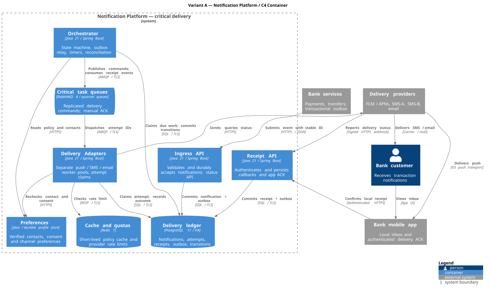
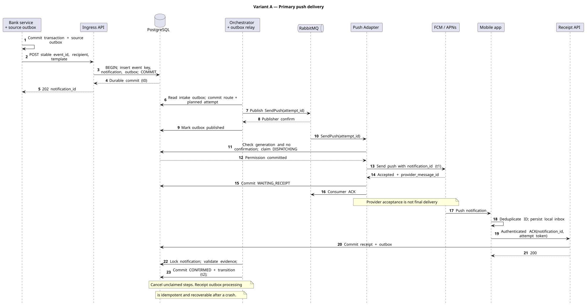
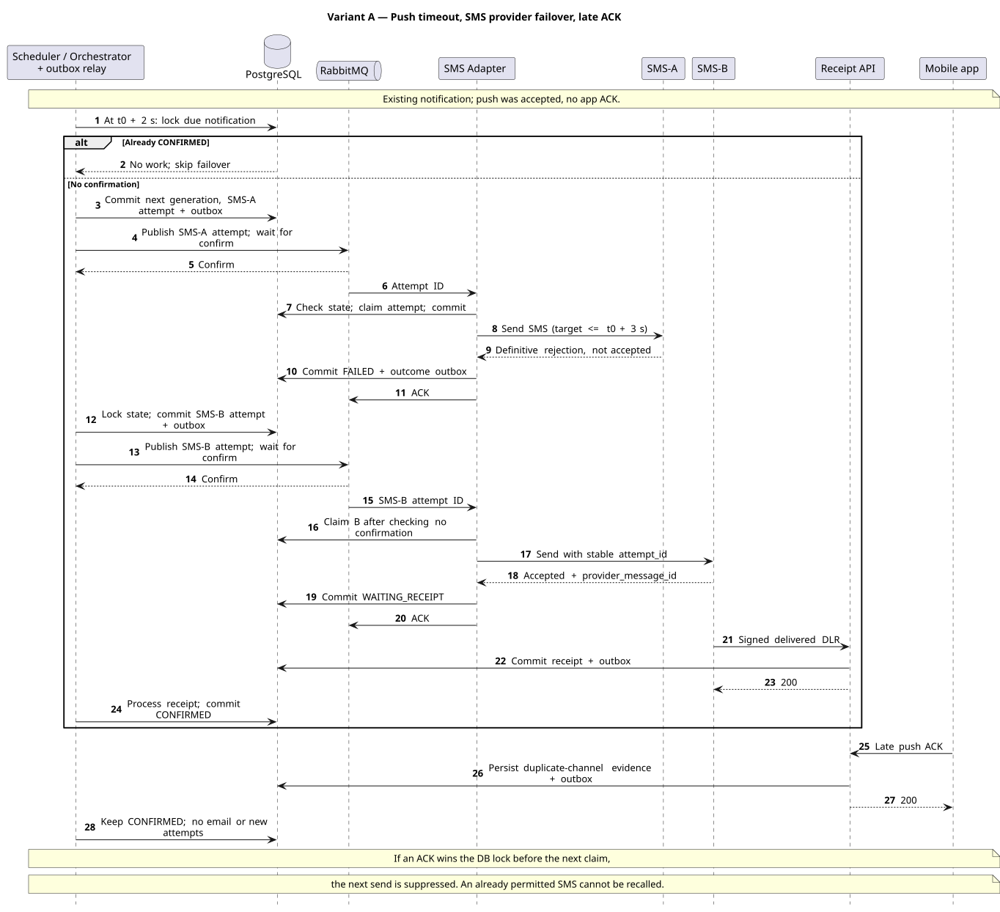
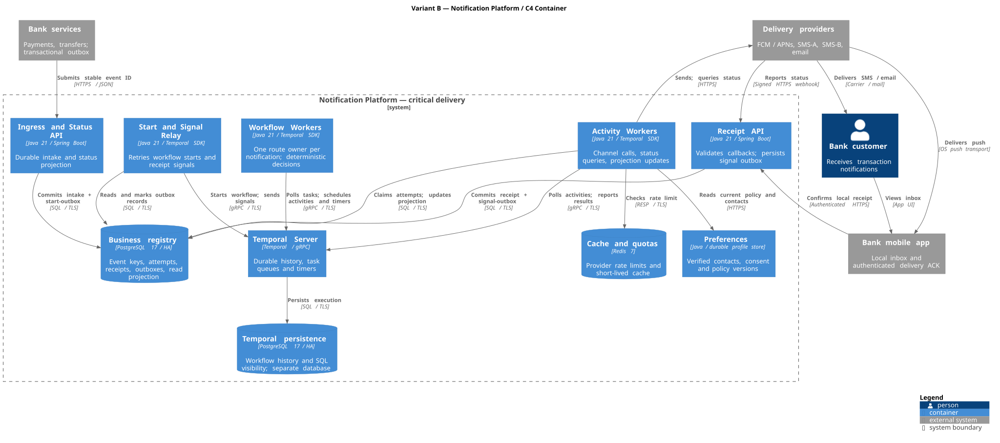
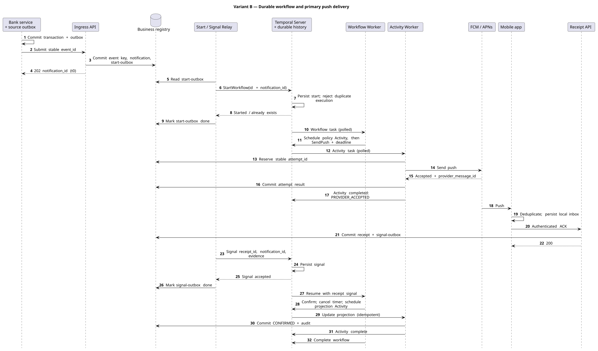
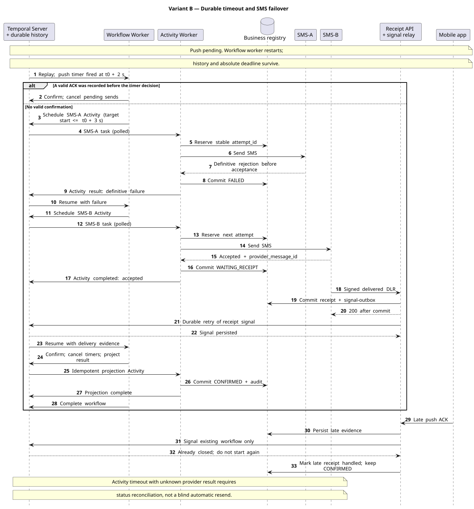

# RFC: гарантированная доставка критичных уведомлений с кросс-канальным failover

| Метаданные | Значение |
| --- | --- |
| Статус | DRAFT |
| Автор(ы) | Andrey Vagabov |
| Ответственный | Andrey Vagabov |
| Бизнес-заказчик | Владелец продукта онлайн-банка — учебная роль |
| Ревьюеры | Не назначены; ревью не проводилось |
| Дата создания | 2026-11-16 |
| Дата обновления | 2026-11-17 |

## Оглавление

1. [Контекст](#контекст)
2. [Продуктовый анализ](#продуктовый-анализ)
3. [Пользовательские сценарии](#пользовательские-сценарии)
4. [Статистика](#статистика)
5. [Требования](#требования)
6. [Варианты решения](#варианты-решения)
7. [Сравнительный анализ](#сравнительный-анализ)
8. [Выводы](#выводы)
9. [Связанные задачи](#связанные-задачи)
10. [Приложения](#приложения)

## Контекст

Команды банка отправляют уведомления самостоятельно: сообщения задерживаются, дублируются и теряются. Notification Platform централизует push, SMS и email. RFC определяет доставку критичных уведомлений об уже совершённых операциях; выполнение платежей и OTP — вне области.

## Продуктовый анализ

Цели банка: retention +15%, жалобы −30%, гарантированная доставка критичных сообщений. Настройки и ограничение частоты поддерживают retention; failover и защита от дублей сокращают пропуски и жалобы. Результат проверяется A/B-тестом D30 retention и числом жалоб на 10 000 получателей. RFC непосредственно решает задачу критичной доставки; влияние на retention требует проверки.

## Пользовательские сценарии

| Приоритет | Тип сценария | Действующее лицо | Сценарий |
| --- | --- | --- | --- |
| MUST HAVE | Основной | Клиент | Получает push о списании; система фиксирует подтверждение |
| MUST HAVE | Failover | Клиент | При отсутствии push получает SMS, при отказе SMS — email |
| MUST HAVE | Настройки | Клиент | Выбирает основной канал; отключает сервисные и маркетинговые сообщения, сохраняя критичные |
| MUST HAVE | Контроль | Поддержка | Видит попытки и причины недоставки; при отказе всех каналов получает сигнал о проблеме |
| MUST HAVE | Повтор события | Команда банка | Повторно передаёт событие и получает прежний ID уведомления |

## Статистика

Из условия: MAU 10 млн, DAU 3 млн, до 300 000 одновременных пользователей. Допущения: частоты относятся к DAU, пик в 10 раз выше среднего; все сроки, мощности и тарифы ниже — проектные оценки.

| Категория | В сутки | В среднем | Расчётный пик |
| --- | --- | --- | --- |
| Транзакционные | 3 млн × 2 = 6 млн | 69/с | 700/с |
| Сервисные | 3 млн × 3 = 9 млн | 104/с | 1 040/с |
| Маркетинговые | 3 млн × 5 = 15 млн | 174/с | 1 740/с |
| Всего | 30 млн | 347/с | ≈3 500/с |

Оба варианта рассчитаны на 6 млн критичных сообщений/сутки и 700/с на пике. Постоянные соединения пользователей обслуживает приложение банка.

## Требования

Обозначения соответствуют [заданиям 1–7](requirements.md). MUST HAVE — обязательно; SHOULD HAVE — желательно без ущерба обязательным требованиям.

### Функциональные требования

| № | Приоритет | Обозначение | Требование |
| --- | --- | --- | --- |
| 1 | MUST HAVE | F1 | Принимать уведомления всех категорий и сообщать результат доставки |
| 2 | MUST HAVE | F2 | Доставлять критичные сообщения приоритетно с автоматическим резервом |
| 3 | MUST HAVE | F3 | Учитывать предпочтения; разрешать отключение сервисных и маркетинговых сообщений, но не всех критичных |
| 4 | MUST HAVE | F4 | Подавлять повтор события и прекращать ещё не начатые отправки после подтверждения |
| 5 | MUST HAVE | F5 | Обрабатывать кампании до 1 млн получателей с учётом согласий и частоты |
| 6 | MUST HAVE | F6 | Показывать историю попыток; сообщать о недоставке и продолжать после восстановления |
| 7 | MUST HAVE | F7 | Без предпочтений выбирать самый дешёвый канал, укладывающийся в срок |

### Нефункциональные требования

SLO измеряются за 30 дней при расчётной нагрузке.

| № | Приоритет | Обозначение | Требование |
| --- | --- | --- | --- |
| 1 | MUST HAVE | N1 | Приём p99 ≤200 мс; первый запрос p99 ≤1 с; ACK доступного push p95 ≤2 с от приёма |
| 2 | MUST HAVE | N2 | ≥99,9% подтверждений за 60 с при валидном контакте и доступном маршруте; отдельно считать доставку по всем сообщениям |
| 3 | MUST HAVE | N3 | Доступность приёма ≥99,95%; RPO=0, RTO ≤60 с при отказе зоны |
| 4 | MUST HAVE | N4 | 3 500 уведомлений/с, включая 700 критичных/с, плюс кампания 1 млн за ≤30 мин без нарушения N1 |
| 5 | MUST HAVE | N5 | Дедупликация событий 90 дней; ноль новых разрешений отправки после подтверждения; наблюдаемые межканальные дубли ≤0,1% |
| 6 | MUST HAVE / SHOULD HAVE | N6 | MUST: обновлять настройки за ≤60 с. SHOULD: в штатном режиме SMS ≤10%, стоимость ≤0,08 условной единицы на критичное сообщение |
| 7 | MUST HAVE | N7 | История 100% критичных сообщений; алерт в течение минуты после нарушения срока 60 с |
| 8 | MUST HAVE | N8 | Все соединения зашифрованы; подтверждения проверяются; все действия операторов журналируются; контактов и текста нет в обычных логах |

### Архитектурно значимые требования

A1 — надёжность, A2 — скорость и масштабирование, A3 — защита от дублей, A4 — наблюдаемость и безопасность: **P0**, обязательны для запуска. A5 — настройки и стоимость: **P1**, оптимизация без нарушения обязательных правил. Связи с требованиями и влияние на архитектуру — в [п. 3](requirements.md#3-архитектурно-значимые-требования), выполнение обоими вариантами — в сравнительном анализе ниже.

### Расчёт нагрузок

Кампания на 1 млн за 30 мин добавляет `1 000 000 / 1 800 ≈556/с`: вместе ≈4 056/с. Для запаса проверяем приём 5 000/с. Число одновременных пользователей само по себе не определяет частоту уведомлений. Если частоты относятся ко всем MAU, базовую мощность нужно увеличить в 3,33 раза.

При отказе push каждый из двух независимых SMS-провайдеров должен выдерживать 700 SMS/с. Четыре последовательные попытки (push, SMS-A, SMS-B, email) дают до 2 800 запросов/с без учёта повторов и подтверждений. Простой 30 мин создаёт `700 × 1 800 = 1,26 млн` заданий; при мощности 1 400/с и входе 700/с очередь разгрузится ещё за 30 мин при достаточных квотах провайдеров.

Допустим, 8% сообщений требуют SMS, 1% — email; цена push/SMS/email равна 0,001/0,50/0,01 условной единицы. Средняя стоимость: `0,001 + 0,08 × 0,50 + 0,01 × 0,01 = 0,0411`, ниже N6. При отказе push расходы вырастут примерно до 0,50 на сообщение; бюджет вызывает алерт, но не блокирует доставку.

Для Temporal при допущении 20–40 событий истории на workflow дополнительно получаем 120–240 млн событий/сутки. Объём нужно подтвердить измерением.

## Варианты решения

### Общие правила доставки

Гарантия начинается после сохранения задания: только тогда API отвечает `202`. Источник сохраняет событие вместе с банковской операцией в outbox — таблице для надёжной последующей передачи — и повторяет запрос с тем же ID до ответа.

| Канал | Достаточное подтверждение |
| --- | --- |
| Push | ACK авторизованного приложения о получении уведомления |
| SMS | Отчёт провайдера о доставке на устройство |
| Email | Подтверждение приёма почтовым сервером адресата |

Приём запроса провайдером не означает доставку. Прочтение человеком не гарантируется. При недоступности всех каналов задание сохраняется, создаётся сигнал поддержке, попытки продолжаются после восстановления. Доставка требует валидного контакта и доступности хотя бы одного допустимого маршрута.

Предпочтительный канал идёт первым; иначе используется push. Резерв — оставшиеся доступные каналы, SMS обслуживают два независимых провайдера. Перед каждой отправкой проверяются актуальные настройки и подтверждённые контакты. Критичные сообщения нельзя полностью отключить; сервисные и маркетинговые можно, маркетинг требует согласия.

| Событие | Действие |
| --- | --- |
| Push первым, нет ACK к 2 с от приёма | Начать SMS не позднее 3 с, p99 |
| Явный отказ канала | Начать резерв за ≤1 с, p99 |
| SMS без подтверждения | Проверить статус; после бюджета 10 с на провайдера перейти к следующему |
| Email без подтверждения | Ждать до 15 с; быстрый цикл ограничить 45 с от приёма |
| Подтверждения нет к 60 с | Зафиксировать нарушение срока; повторять с растущими интервалами и случайным разбросом, уведомить поддержку |

Если push идёт после другого канала, его бюджет — 2 с от начала шага. Тайм-аут внешнего запроса означает неизвестный результат (`UNKNOWN`): сначала запрашивается статус, повтор допустим с прежним ключом при поддержке идемпотентности. При переключении после `UNKNOWN` фиксируется риск дубля. Лимиты скорости и circuit breaker временно отключают обращения к неисправному провайдеру.

Повтор события возвращает прежний ID; команды и подтверждения дедуплицируются. Ключи событий хранятся 90 дней, более старые повторы требуют сверки. После `CONFIRMED` новые отправки запрещены. TLS, права на категории, проверка подписей callback и принадлежности ACK защищают границы; контакты шифруются, в очередях передаются ссылки.

Для каждого ID ведётся журнал. OpenTelemetry, Prometheus и Grafana показывают задержки, возраст очереди, причины failover, дубли и стоимость по каналам. Зависшие сообщения входят в нарушения SLO; отсутствие ACK само по себе не доказывает недоступность контакта.

### Вариант 1: PostgreSQL + RabbitMQ (A)

#### Архитектура

Java 21/Spring Boot: Ingress API принимает задания, Orchestrator управляет маршрутом и таймерами, Delivery Adapters вызывают каналы, Receipt API принимает подтверждения, Preferences хранит настройки. PostgreSQL 17 хранит состояние, попытки, историю и outbox; RabbitMQ 4 с quorum queues передаёт задания; Redis 7 используется для кэша и квот. Push — FCM/APNs; SMS/email-провайдеры выбираются после проверки квот и подтверждений.

API атомарно сохраняет уведомление и outbox. Relay публикует задание с подтверждением RabbitMQ; воркер подтверждает обработку после фиксации результата в БД. Оркестратор выбирает сохранённые сроки `next_action_at` и блокирует строку уведомления при переходе состояния. Перед внешним вызовом адаптер проверяет текущую попытку и отсутствие подтверждения, затем атомарно получает разрешение отправки.

Основной сценарий: приём → очередь → push → ACK приложения → `CONFIRMED`, отмена ещё не разрешённых отправок.

Failover: нет ACK к 2 с → SMS-A → явный отказ → SMS-B → подтверждение доставки. Поздний ACK push сохраняется, но не запускает новые попытки.

Критичный поток имеет отдельные БД, брокер и пулы адаптеров. PostgreSQL: primary и две реплики в трёх зонах, синхронная фиксация минимум на одной другой зоне; Patroni/etcd, продвижение только актуальной реплики и изоляция старого primary. RabbitMQ: три узла с quorum queues. Если безопасная запись невозможна, приём останавливается, источники сохраняют outbox.

#### Этапы реализации

Сроки обоих вариантов — оценки при опыте команды с PostgreSQL/RabbitMQ, но без действующей платформы Temporal; SRE и мобильный разработчик участвуют по 0,5 ставки.

| Этап | Описание | Планируемый срок | Ресурсы | Риски |
| --- | --- | --- | --- | --- |
| 1 | API, outbox, БД и брокер с репликацией | Недели 1–2 | 2 backend, SRE | Ошибки восстановления |
| 2 | Каналы, настройки, таймеры, ACK и защита от дублей | Недели 3–4 | 2 backend, mobile | Квоты провайдеров, поздние ACK |
| 3 | Проверки нагрузки и сбоев, пилот, постепенное подключение | Недели 5–6 | 2 backend, 1 QA, SRE, mobile | Нарушение SLO на реальных каналах |

#### Преимущества

Прямой контроль состояния; знакомый команде стек; подходит фиксированному маршруту.

#### Недостатки

Собственные планировщик и восстановление; пропускную способность PostgreSQL нужно проверить.

### Вариант 2: Temporal (B)

#### Архитектура

Java 21/Temporal Java SDK; Temporal Server с PostgreSQL 17 для истории; отдельный PostgreSQL 17 для реестра уведомлений; Redis 7 для кэша и квот. Каналы и средства наблюдаемости те же. Вместо RabbitMQ используются task queues Temporal; отправки выполняют Activity Workers, маршрут определяют Workflow Workers.

API сохраняет уведомление и start-outbox. Relay запускает workflow с ID уведомления; повторный запуск запрещён. Temporal сохраняет историю и таймеры. Receipt API сохраняет подтверждение и signal-outbox, relay передаёт сигнал workflow. Следующий шаг определяет только workflow; бизнес-БД хранит реестр попыток и проекцию результата.

Основной сценарий: приём → запуск workflow → push Activity → ACK через signal → завершение workflow и обновление результата.

Failover: сохранённый таймер истёк → SMS-A Activity → отказ → SMS-B Activity → сигнал о доставке → завершение. Перезапуск воркера не теряет ожидание. Без идемпотентности провайдера автоматические повторы отправляющей Activity отключены; после тайм-аута проверяется статус.

Для критичных workflow выделяются отдельные кластер и БД; Activity Workers масштабируются по каналам. Обе PostgreSQL реплицируются синхронно по той же схеме, что в A; сервисы Temporal и воркеры распределяются по зонам. При отсутствии безопасной записи приём останавливается.

#### Этапы реализации

| Этап | Описание | Планируемый срок | Ресурсы | Риски |
| --- | --- | --- | --- | --- |
| 1 | Temporal, реплицированные БД, API и start/signal outbox | Недели 1–3 | 2 backend, SRE | Освоение и эксплуатация Temporal |
| 2 | Workflow, Activities, каналы, настройки и ACK | Недели 4–5 | 2 backend, mobile | Повторы внешних вызовов, совместимость истории |
| 3 | Проверки нагрузки, replay и сбоев, пилот | Недели 6–7 | 2 backend, 1 QA, SRE, mobile | Рост истории, задержки планирования |

#### Преимущества

Готовые сохраняемые таймеры и восстановление; удобнее для долгих, ветвящихся процессов.

#### Недостатки

Дополнительная платформа и запись истории; обновления требуют совместимости workflow. Внешние дубли всё равно обрабатываются приложением.

## Сравнительный анализ

### Ресурсные требования

| Критерий | Вариант 1: A | Вариант 2: B |
| --- | --- | --- |
| Время реализации | 6 недель | 7 недель, включая освоение Temporal |
| Команда | 2 backend, 1 QA, по 0,5 ставки SRE и mobile | Та же команда |
| Инфраструктура | PostgreSQL, RabbitMQ, Redis, приложения | Две PostgreSQL, Temporal, Redis, workers |
| Организационные риски | Собственный код таймеров и восстановления | Новая компетенция, сопровождение и версионирование workflow |

### Соответствие требованиям

В таблице показаны механизмы выполнения каждого ASR. Достижение численных SLO требует испытаний.

| ASR и требования | Вариант 1: A | Вариант 2: B |
| --- | --- | --- |
| A1: F1, F2, F6; N2, N3 | Outbox, репликация, quorum queues, сохранённые сроки и резерв каналов | Start/signal outbox, сохраняемые workflow и таймеры, репликация, резерв каналов |
| A2: F2, F5; N1, N4 | Отдельные ресурсы критичного потока, масштабируемые адаптеры; кампании ограничены квотами | Выделенный Temporal, task queues и Activity Workers; кампании в отдельном контуре |
| A3: F4; N5 | Ключ события и ID попытки; транзакция разрешает гонку таймера и ACK | Workflow ID и реестр попыток; последовательная история и дедупликация сигналов |
| A4: F6; N7, N8 | Журнал переходов, метрики, проверка callback, шифрование и роли доступа | История workflow и бизнес-журнал; те же метрики и защита |
| A5: F3, F5, F7; N6 | Preferences, актуальные согласия, ограничения частоты, дешёвый маршрут и квоты | Настройки через Activity, версия политики в workflow, те же ограничения и учёт стоимости |

## Выводы

Выбран **вариант A**: маршрут короткий и фиксированный, а Temporal добавляет инфраструктуру и запись истории, не устраняя неопределённость внешней отправки. Цена выбора — собственные таймеры и восстановление. При уже используемом Temporal вариант B может быть дешевле в сопровождении.

Ключевые ограничения: быстрый failover повышает стоимость и допускает поздний push после SMS; уже начатую отправку нельзя гарантированно отозвать. Доставка требует доступного контакта и канала. Дубли оцениваются по нескольким подтверждениям одного ID и клиентской телеметрии — это нижняя оценка. RPO=0 покрывает отказ зоны, но не потерю региона; сохранность важнее приёма при потере кворума.

## Связанные задачи

1. Измерить поток и долю push ACK за 2 с; проверить квоты, тарифы, подтверждения и независимость провайдеров — [неопределённости](requirements.md#7-неопределённости-и-риски).
2. Подключить outbox источника, ACK приложения и callback провайдеров; проверить маршруты без отправок.
3. Проверить N1–N8: нагрузку с кампанией, отказ зоны и каналов, повтор события, потерю callback, падение после отправки, гонку ACK с таймером; восстановление из резервной копии. Для B — также replay. Внешнюю доставку проверить пилотом.
4. Постепенно подключать пользователей; у события один отправитель. При откате новые события идут прежней системе, принятые завершает текущая.

Это план реализации и проверки, а не результаты тестирования.

## Приложения

[Задания 1–7](requirements.md). [Шесть диаграмм: PlantUML, SVG и PNG](diagrams/README.md).

### Глоссарий

| Термин | Определение |
| --- | --- |
| ASR | Требование, определяющее архитектурные решения |
| Failover | Автоматический переход на резервный канал или провайдера |
| Outbox | Таблица событий для надёжной передачи после фиксации основной операции |
| ACK | Подтверждение получения сообщения |
| SLO | Измеримая целевая характеристика сервиса |
| RPO / RTO | Допустимая потеря данных / время восстановления |
