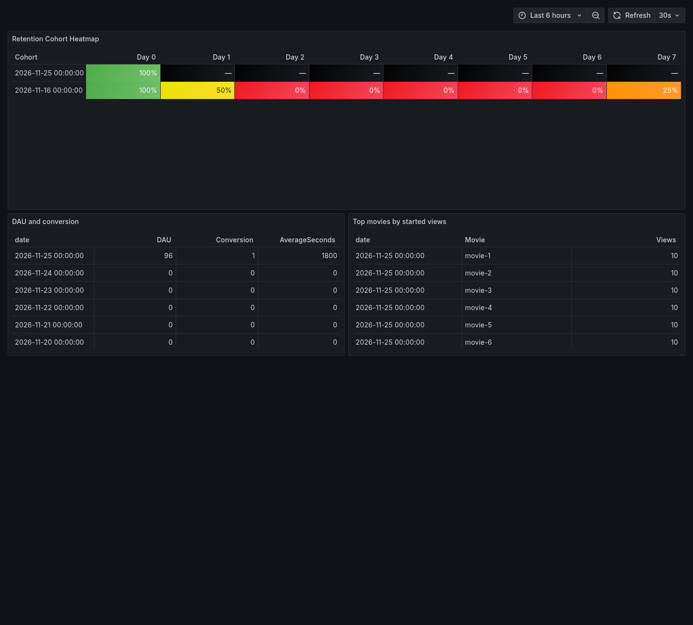

# Проверка ДЗ5 по критериям задания

Условие: «Online Cinema: Event Streaming + Analytics Pipeline», 8 пунктов,
максимум 10 баллов. Эта таблица сопоставляет реализацию и воспроизводимые проверки;
оценку выставляет преподаватель.

## Как воспроизвести

```sh
cd hw5
./test.sh
```

Нужны Docker Compose v2, Bash, Python 3 и GNU date. При отсутствии доступа к Docker:
`sudo ./test.sh`. Runner создаёт новый проект `soa-hw5-test-*` без внешних портов,
с чистыми volumes, автоматически запускает миграции, тесты и удаляет тестовый стек.
Демонстрационный проект `soa-hw5` не останавливается и его данные не удаляются.
Повторный запуск проверяет воспроизводимость на новой БД.

## Соответствие пунктам

| Пункт и баллы | Реализация | Доказательство |
| --- | --- | --- |
| 1. Схема и Kafka, 1 | `schemas/movie-event-v1.avsc`, регистрация subject `movie-events-value`, BACKWARD, 3 партиции. Ключ `user_id` сохраняет порядок пользователя; объяснение в README. UUID валидируется Rust и хранится как UUID в ClickHouse; Avro передаёт строковое представление. | Unit roundtrip всех enum/device, e2e проверяет версию 1 и метаданные Kafka; resilience проверяет BACKWARD и параметры topic. |
| 2. Продюсер, 1 | `src/bin/producer.rs`: POST /events, валидация, Avro, acks=all, idempotence, exponential backoff 100–5000 ms, журнал event_id/type/timestamp. Генератор создаёт связанные сессии. | E2e проверяет 201 и event_id, ошибки 400, все поля в ClickHouse; resilience проверяет последовательность SEARCHED → STARTED → PAUSED → RESUMED → FINISHED → LIKED и неубывающий progress. |
| 3. Ingestion, 1 | `sql/clickhouse.sql`: Kafka Engine + MV → ReplacingMergeTree; месячные партиции, сортировка день/user/event. | Событие, отправленное только через API, появляется в raw_events; проверяются все 9 полей, повторная доставка не увеличивает FINAL count. |
| 4. Интеграционный тест, 1 | `tests/e2e.rs`, `test.sh`; отдельные volumes, UUID, чистая БД. | Одна команда поднимает и проверяет весь путь API → Kafka → ClickHouse без ручных действий. |
| 5. Агрегация, 3 | Отдельный контейнер `aggregation`; `sql/metrics.sql` читает raw FINAL, использует uniqExact/avgIf/countIf/min; сохраняет все метрики в CH и PG. Интервал настраивается; POST /aggregate/{date}. PG UPSERT в транзакции, 3 попытки с backoff. Логи начала/конца, processed, elapsed_ms. | Два пользователя: DAU=2, avg=1200, conversion=0.5, D0=1, D1/D7=0.5, D2–D6=0; повторный расчёт без дублей, проверка материализации CH. Resilience проверяет автоматический расчёт, логи и восстановление PG. |
| 6. Grafana, 1 | Provisioning datasource и dashboard. Таблица когорт Day 0–7, проценты и цвет фона; дополнительные панели DAU/conversion/avg и top movies. Все запросы к daily_metrics. | E2e читает provisioned dashboard, проверяет SQL и health datasource, исполняет каждый запрос через Grafana `/api/ds/query` и проверяет data frames без ошибок. |
| 7. Экспорт, 1 | RustFS — разрешённый условием S3-аналог. Экспорт из PG в JSON, date/metric/dimension/value/computed_at, фиксированный ключ `movie-analytics/daily/YYYY-MM-DD/aggregates.json`. Расписание и POST /export/{date}. | Двойной экспорт, чтение реального S3-объекта, обязательные метрики; resilience проверяет автоматический вчерашний объект, 503 при отказе S3/PG и восстановление экспорта. |
| 8. Kafka HA, 1 | Три broker/controller KRaft, replication.factor=2, min.insync.replicas=1, Schema Registry. Healthcheck у всех длительно работающих компонентов. Одноразовые init jobs проверяются по успешному exit code. | Resilience читает реальные метаданные, останавливает лидера партиции, публикует 12 событий и дожидается ClickHouse; после восстановления проверяет возвращение двух реплик в ISR каждой партиции. |

## Что показать преподавателю

1. Запуск: `docker compose up --build -d --wait --wait-timeout 300`; затем `docker compose ps`.
2. Вывод `./test.sh`: успешные Rust-тесты и строки `PASS:` проверок отказов.
3. Grafana: http://localhost:3005/d/cinema — admin / cinema-local-admin.
4. Ручной пересчёт и экспорт за нужную UTC-дату командами из README.
5. В RustFS Console http://localhost:9006 открыть бакет movie-analytics и файл daily/DATE/aggregates.json.
6. Объяснить user_id partition key, FINAL-дедупликацию, формулы метрик и UPSERT.

У нового демо ещё нет семидневной истории: исторические D1/D7 доказываются
изолированными тестами с событиями за прошлые даты. Пустые незрелые ячейки heatmap
не означают ошибку. Retention считается от первого VIEW_STARTED; возврат — событие
просмотра. Среднее время — progress завершённых просмотров, как указано в условии.

## Границы проверки

Это функциональная проверка учебного стека, не нагрузочный тест. Проверяется
остановка одного брокера; одновременная потеря двух узлов и физическая потеря дисков
не проверяются. RustFS использует один локальный диск. Поздние события старше семи
дней требуют ручного пересчёта/экспорта; автоматическое окно описано в README.
Локальные исключения VPN и параметры сети машины в репозиторий не входят.

## Результат фактического прогона

Проверено 26.11.2026 (Europe/Moscow): полный `./test.sh` завершился с кодом 0.
Rust: 2 unit-теста и 3 e2e; S3 readback и все 7 групп проверок `resilience.py`
успешны, в том числе доставка при остановленном kafka-2 и восстановление всех ISR.
После правки отображения пустых когорт отдельно повторён Grafana e2e.

Дашборд также открыт в Chromium: таблица Day 0–7, цветные проценты и две
дополнительные панели отображаются. Для локальной демонстрации добавлена
синтетическая когорта из четырёх пользователей: D1=50%, D7=25%.


